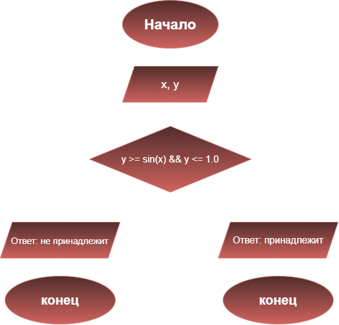

# Домашнее задание №6
## Условие задачи
Написать программу, удовлетворяющую рисунку
## 1.Алгоритм и блок-схема
### Алгоритм
1. **Начало** 
2. Задать исходные файлы:
- `x` - координата точки по оси абсцисс
- `y` - координата точки по оси ординат
3. Проверяем условие: 
- `(y >= sin(x) && y <= 1.0)`
4. Вывести результат проверки условия на экран с подстановкой всех значений в текст.
5. **Конец**

### Блок-схема



## 2. Реализация программы
```c 
#include <stdio.h>
#include <locale.h>
#define _USE_MATH_DEFINES
#include <math.h>
int main() {
	setlocale(LC_CTYPE, "RUS");
	double x, y;
    printf("Контрольный пример: точка с координатами (1, 1) принадлежит закрашенной области\n");
    printf("Контрольный пример: точка с координатами (5, 2) не принадлежит закрашенной области\n");
	printf("Введите координаты точки\n");
	printf("Введите значение х: ");
    scanf("%lf", &x);
    printf("Введите значение у: ");
	scanf("%lf", &y);
	if (y >= sin(x) && y <= 1.0) {
         prinf("Точка с координатами (%.2f, %.2f) принадлежит закрашенной области\n", x, y);
	     printf("Ответ: принадлежит\n");
	} 
    else {
         printf("Точка с координатами (%.2f, %.2f) не принадлежит заданной области\n", x, y);
         printf("Ответ: не принадлежит\n");
	}
    return 0;
}
```

## 3. Результаты работы программы 
```c
Контрольный пример: точка с координатами (1, 1) принадлежит закрашенной области
Контрольный пример: точка с координатами (5, 2) не принадлежит закрашенной области
Введите координаты точки
Введите значение x: 1
Введите значение у: 1
Точка с координатами (1.00, 1.00) принадлежит закрашенной области
Ответ: принадлежит
```


## 4. Информация о разработчике
Выполнила Яценко Анна, группа бОТИ-261
